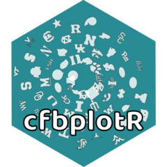
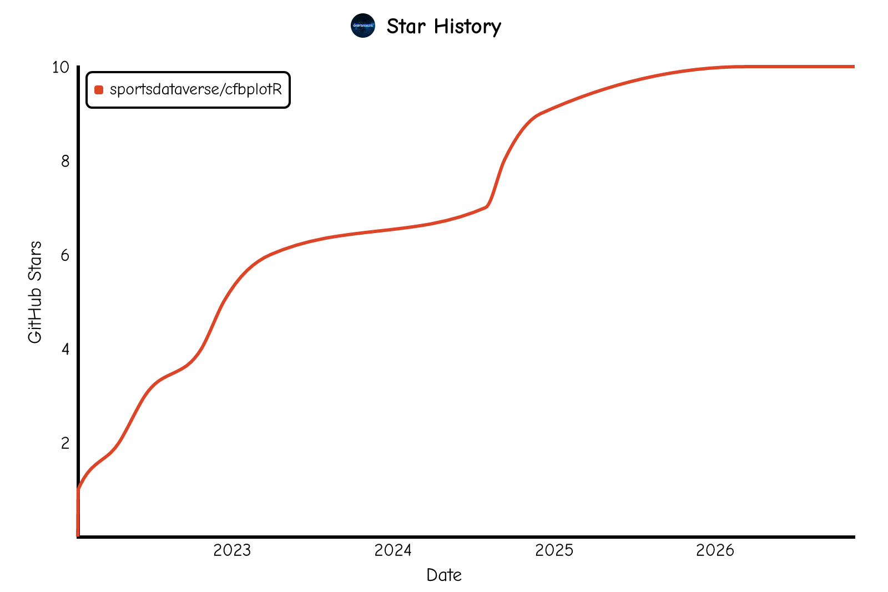

<!-- README.md is generated from README.Rmd. Please edit that file -->

# **cfbplotR** <a href='https://cfbplotR.sportsdataverse.org/'></a>

<!-- badges: start -->

[](https://sportsdataverse.r-universe.dev/cfbplotR)
[](https://github.com/sportsdataverse/cfbplotR/)
[](https://github.com/sportsdataverse/cfbplotR/actions/workflows/R-CMD-check.yaml)
[](https://app.codecov.io/gh/sportsdataverse/cfbplotR)
[](https://github.com/sportsdataverse/cfbplotR/actions/workflows/pkgdown.yaml)
[](https://lifecycle.r-lib.org/articles/stages.html#experimental)
[](https://github.com/sportsdataverse/cfbplotR/blob/main/LICENSE.md)
[](https://github.com/sportsdataverse/cfbplotR/graphs/contributors)
[](https://github.com/sportsdataverse/cfbplotR/stargazers)
[](https://x.com/SportsDataverse)
[](https://x.com/JaredDLee)

<!-- badges: end -->

[**`cfbplotR`**](https://cfbplotR.sportsdataverse.org/) is an R package
for plotting College Football (CFB) team logos, player headshots,
wordmarks, and conference logos in
[**`ggplot2`**](https://ggplot2.tidyverse.org/) graphics and
[**`gt`**](https://gt.rstudio.com/) tables. It is built on the
[**`ggpath`**](https://mrcaseb.github.io/ggpath/) package and follows
the conventions established by
[nflplotR](https://nflplotr.nflverse.com/) — porting that proven
approach to college football.

Part of the [SportsDataverse](https://sportsdataverse.org/) family of R
packages for sports analytics.

Data freshness and pipeline status for every SportsDataverse dataset:
[sportsdataverse.org/status](https://sportsdataverse.org/status).

## **Installation**

You can install the latest build from [R-universe](https://sportsdataverse.r-universe.dev/cfbplotR) with:

```r
install.packages("cfbplotR", repos = c("https://sportsdataverse.r-universe.dev", getOption("repos")))
```

You can install the development version of
[**`cfbplotR`**](https://github.com/sportsdataverse/cfbplotR) from
[GitHub](https://github.com/sportsdataverse/cfbplotR) with:

``` r
# using the pak package (recommended):
if (!requireNamespace('pak', quietly = TRUE)){
  install.packages('pak')
}
pak::pak("sportsdataverse/cfbplotR")
```

``` r
# or using the devtools package:
if (!requireNamespace('devtools', quietly = TRUE)){
  install.packages('devtools')
}
devtools::install_github(repo = "sportsdataverse/cfbplotR")
```

``` r
# or clone and install locally
git clone https://github.com/sportsdataverse/cfbplotR
cd cfbplotR
Rscript -e "pak::local_install()"  # or: Rscript -e "devtools::install()"
```

## **Usage**

[You can follow the package tutorial for several detailed
examples.](https://cfbplotR.sportsdataverse.org/articles/tutorial.html)

The core function `geom_cfb_logos()` adds CFB team logos to a ggplot.
Axis helpers (`scale_x_cfb()`, `scale_y_cfb()`) replace axis labels with
team logos via `element_cfb_logo()`. The `gt_fmt_cfb_logo()` helper adds
logos inside `gt` table cells.

``` r
library(cfbplotR)
library(ggplot2)

# grab the first 32 valid team abbreviations
team <- valid_team_names()[1:32]
df <- data.frame(
  a     = rep(1:8, 4),
  b     = sort(rep(1:4, 8), decreasing = TRUE),
  teams = team
)

ggplot(df, aes(x = a, y = b)) +
  geom_cfb_logos(aes(team = teams), width = 0.075) +
  geom_label(aes(label = teams), nudge_y = -0.35, alpha = 0.5) +
  theme_void()
```

``` r
library(cfbplotR)
library(ggplot2)

# logos on the x-axis via scale_x_cfb() + element_cfb_logo()
df2 <- data.frame(
  team  = c("Alabama", "Georgia", "Ohio State", "Michigan"),
  score = c(42, 38, 35, 30)
)

ggplot(df2, aes(x = team, y = score)) +
  geom_col(aes(fill = team), show.legend = FALSE) +
  scale_x_cfb(labels = "logo") +
  theme_minimal() +
  theme(
    axis.text.x = element_cfb_logo(size = 1)
  )
```

``` r
library(cfbplotR)
library(gt)

# logos inside a gt table
data.frame(
  team  = c("Alabama", "Georgia", "Ohio State"),
  wins  = c(13, 12, 11)
) |>
  gt() |>
  gt_fmt_cfb_logo(columns = "team")
```

## **Documentation**

For more information on the package and function reference, please see
the [**`cfbplotR`** documentation
website](https://cfbplotR.sportsdataverse.org).

- [Function reference](https://cfbplotR.sportsdataverse.org/reference/index.html)
- Vignette: [Using cfbplotR](https://cfbplotR.sportsdataverse.org/articles/tutorial.html)
- [NEWS / changelog](https://cfbplotR.sportsdataverse.org/news/index.html)

There is also a printable [**`cfbplotR` cheat sheet (PDF)**](https://sportsdataverse.org/cheatsheets/cfbplotR-cfb4th-cfbseedR.pdf), one of [a set covering every SportsDataverse package](https://sportsdataverse.org/cheatsheets).


## **Companion packages**

- [**`cfbfastR`**](https://cfbfastR.sportsdataverse.org/) supplies the
  college football play-by-play, team and player data to plot.
- [**`sdvplotR`**](https://sdvplotR.sportsdataverse.org/) brings the same
  logo, color and table toolkit to 49 leagues, college football included.
- [**`ggpath`**](https://mrcaseb.github.io/ggpath/) is the image engine
  underneath, and [**`nflplotR`**](https://nflplotr.nflverse.com/) is the
  NFL counterpart whose conventions `cfbplotR` follows.

## **The SportsDataverse**

`cfbplotR` is part of the
[**SportsDataverse**](https://sportsdataverse.org/), a family of
open-source R, Python, and Node.js packages for sports data.

| Package                                                                                                               | Sport / Scope                      |
| --------------------------------------------------------------------------------------------------------------------- | ---------------------------------- |
| [**cfbfastR**](https://cfbfastR.sportsdataverse.org/)                                                                 | College football                   |
| [**hoopR**](https://hoopR.sportsdataverse.org/)                                                                       | Men’s basketball (NBA & NCAA)      |
| [**wehoop**](https://wehoop.sportsdataverse.org/)                                                                     | Women’s basketball (WNBA & NCAA)   |
| [**fastRhockey**](https://fastRhockey.sportsdataverse.org/)                                                           | Hockey (NHL & PWHL)                |
| [**baseballr**](https://billpetti.github.io/baseballr/)                                                               | Baseball (MLB, MiLB, NCAA)         |
| [**oddsapiR**](https://oddsapiR.sportsdataverse.org/)                                                                 | Sports betting odds (The Odds API) |
| [**sportsdataverse-R**](https://r.sportsdataverse.org/)                                                               | Umbrella R metapackage             |
| [**sportsdataverse-py**](https://py.sportsdataverse.org/) · [**sportsdataverse.js**](https://js.sportsdataverse.org/) | Python & Node.js                   |

See the full ecosystem at
[sportsdataverse.org](https://sportsdataverse.org/).

## **Follow the [SportsDataverse](https://x.com/SportsDataverse) on X and star this repo**

[](https://x.com/JaredDLee)

[](https://x.com/SportsDataverse)

[](https://github.com/sportsdataverse/cfbplotR/stargazers/)

<a href="https://github.com/sportsdataverse/cfbplotR/stargazers">
  <picture>
    <source media="(prefers-color-scheme: dark)" srcset="https://raw.githubusercontent.com/sportsdataverse/cfbplotR/star-history/star-history-dark.svg">
    
  </picture>
</a>

## **Our Authors**

  - [Jared Lee](https://x.com/JaredDLee) </br>
    <a href="https://x.com/JaredDLee" target="blank"></a>
    <a href="https://github.com/Kazink36" target="blank"></a>

  - [Saiem Gilani](https://x.com/saiemgilani) </br>
    <a href="https://x.com/saiemgilani" target="blank"></a>
    <a href="https://github.com/saiemgilani" target="blank"></a>

  - [Sebastian Carl](https://x.com/mrcaseb) </br>
    <a href="https://x.com/mrcaseb" target="blank"></a>
    <a href="https://github.com/mrcaseb" target="blank"></a>

## **Code of Conduct**

Please note that the cfbplotR project is released with a [Contributor Code of Conduct](https://cfbplotR.sportsdataverse.org/CODE_OF_CONDUCT.html).
By contributing to this project, you agree to abide by its terms.

## **Citations**

To cite the [**`cfbplotR`**](https://cfbplotR.sportsdataverse.org/) R
package in publications, use:

BibTeX Citation

``` bibtex
@misc{lee_carl_gilani_cfbplotR,
  author = {Lee, Jared and Gilani, Saiem and Carl, Sebastian},
  title = {cfbplotR: The SportsDataverse's R Package for College Football Plotting.},
  url = {https://cfbplotR.sportsdataverse.org},
  year = {2026}
}
```

## **License**

`cfbplotR` is released under the MIT License; see
[LICENSE.md](https://github.com/sportsdataverse/cfbplotR/blob/main/LICENSE.md).
